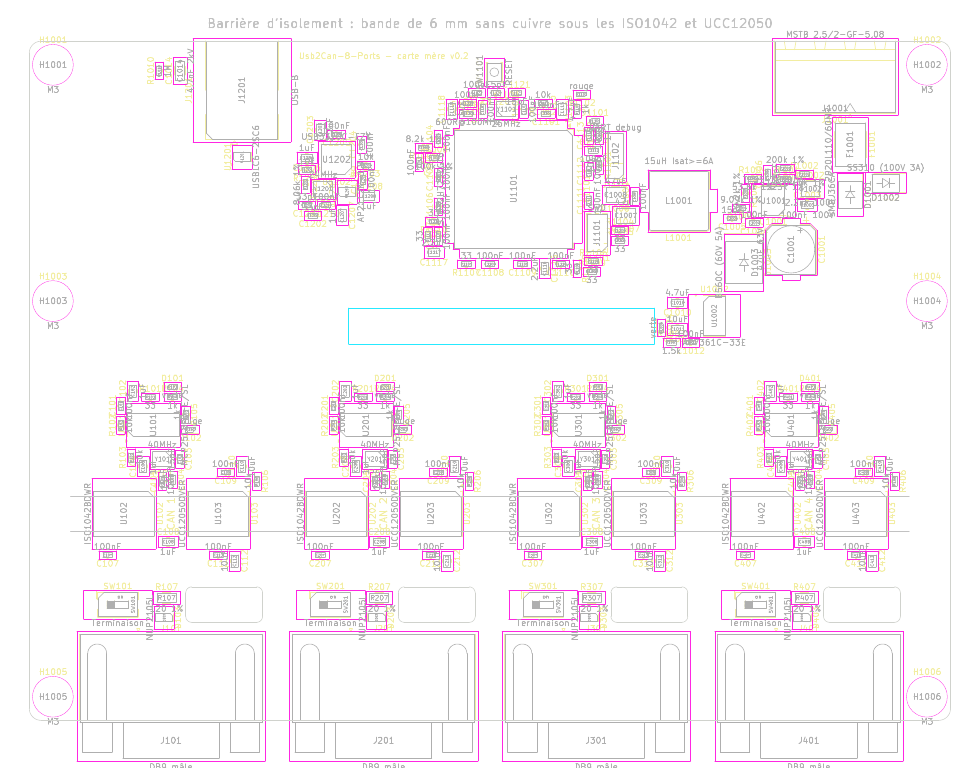
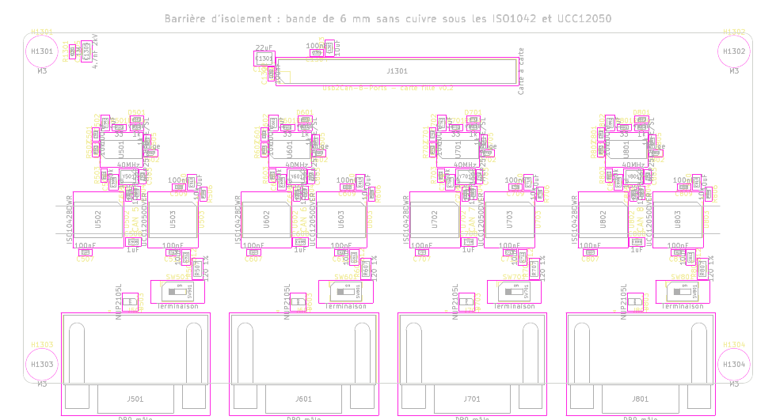
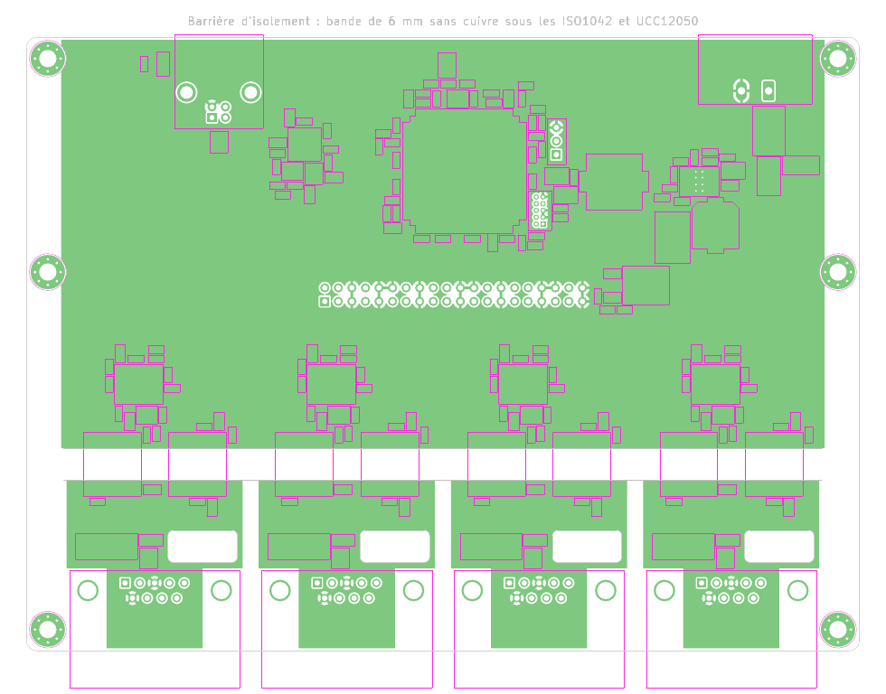

# Placement des composants (v0.2)

Les deux circuits imprimés sont générés par `hardware/outils/placer.py` à partir des schémas v0.2 :

- `hardware/can8-mere/can8-mere.kicad_pcb` ;
- `hardware/can8-fille/can8-fille.kicad_pcb`.

Chaque fichier contient le contour, les trous de fixation, les zones sans cuivre de la barrière d'isolement, les plans internes et tous les composants placés avec leurs nets. **Rien n'est routé** : le chevelu montre les liaisons à tirer. Les vues PDF du placement sont à côté de chaque carte (`*-placement.pdf`).





## 1. Dimensions et empilage

| | Carte mère | Carte fille |
|---|---|---|
| Dimensions | 156 × 115 mm | 156 × 75 mm |
| Couches | 4 | 4 |
| Composants | 212, tous sur le dessus sauf l'embase carte à carte | 123, tous sur le dessus |
| Trous M3 (reliés au châssis) | 6 | 4, en face de 4 trous de la mère |

- La carte fille est **sous** la carte mère, alignée sur le bord avant. Les DB9 des ports 5 à 8 sont exactement sous ceux des ports 1 à 4.
- Les deux fichiers utilisent le même repère : un même point (x, y) est sur la même verticale une fois les cartes empilées. y va de l'arrière (USB, alimentation) vers l'avant (DB9).
- **Hauteur d'empilage ≈ 15 mm** entre le dessus de la fille et le dessous de la mère. Un DB9 coudé avec boîtier mesure environ 12,6 mm de haut, et celui de la fille doit passer sous la mère. L'entraxe vertical des DB9 en face avant est alors d'environ 16,6 mm. La note du schéma v0.1 (≈ 11 mm) est corrigée.
- Le connecteur carte à carte est une embase femelle 2 × 20 au dos de la mère et une barrette mâle sur la fille. Une barrette standard dans une embase standard donne 11 mm : il faut une barrette à corps surélevé ou à broches longues pour atteindre 15 mm, à choisir avec le DB9 réel.
- Les empreintes KiCad de l'embase et de la barrette sont dessinées en miroir l'une de l'autre. Embase retournée sous la mère, barrette sur la fille : les 40 broches se superposent avec la même numérotation, donc le brochage du schéma ne change pas. Le script le vérifie broche par broche (voir § 5).

## 2. Organisation d'un port

Chaque port occupe une colonne de 36 mm de large (axes à x = 24, 60, 96 et 132 mm). De l'avant vers l'arrière :

1. **DB9** au bord avant, broches à 12,74 mm du bord (empreinte « EdgePinOffset 9,90 mm »).
2. **Côté bus** (masse GND_ISO, 5 V isolé VISO) : protection NUP2105L contre le DB9, interrupteur de terminaison et résistance de 120 Ω, découplages VISO.
3. **Barrière d'isolement** : ISO1042 (à gauche) et UCC12050 (à droite) côte à côte, broches 1 à 8 côté logique, 9 à 16 côté bus. Une bande de 6 mm (y = 77 à 83 mm) est interdite à tout cuivre sur les 4 couches : pistes, vias, pastilles et plans. Elle laisse libres les 7 mm de chaque bord de carte pour la piste du châssis.
4. **Côté logique** (masse GND, 3,3 V) : MCP2518FD, quartz 40 MHz et ses condensateurs, découplages, résistances de tirage, LED d'activité et d'erreur.

Entre deux ports, côté bus, une bande de 3 mm est interdite au cuivre : les masses isolées de deux ports voisins ne se touchent pas. Sous les DB9, la piste du châssis peut relier les pattes de fixation des DB9 entre elles et aux trous avant.



**Plans internes**

| Couche | Rôle |
|---|---|
| F.Cu | composants et signaux |
| In1.Cu | GND sous toute la partie logique, un plan GND_ISO par port côté bus |
| In2.Cu | +3V3 sous la partie logique, un plan VISO par port côté bus |
| B.Cu | signaux |

Les plans isolés ont une forme en T. Ils s'arrêtent à 1,5 mm des pattes de fixation du DB9, qui sont reliées au châssis. Le 5 V passe en pistes (classe « Alim », 0,5 mm). Les plans des couches externes seront ajoutés après le routage.

## 3. Carte mère, partie arrière

- **STM32H723** au centre. Son orientation est choisie par le script pour rapprocher chaque broche du composant qu'elle rejoint : les SPI, chip-selects et interruptions des ports 1 à 4 regardent l'avant, l'ULPI regarde le PHY, et les SPI des ports 5 à 8 rejoignent le connecteur carte à carte placé dessous.
- **USB3320** à gauche du MCU. Le connecteur USB-B est au bord arrière gauche, avec l'USBLC6 juste derrière ses broches.
- **Alimentation** dans le coin arrière droit, dans l'ordre du courant : bornier, PTC, TVS, diode série, condensateur d'entrée, TPS54360, diode B560C, inductance, condensateurs de sortie, puis le LDO 3,3 V.
- **SWD et UART de débogage** à droite du MCU, **bouton reset** derrière lui, chacun au plus près de ses broches. La partie arrière de la mère n'est pas recouverte par la fille, donc ils restent accessibles.
- **Liaison châssis-masse** (1 MΩ // 4,7 nF 2 kV) près du connecteur USB, dont le blindage est l'entrée de décharge la plus probable.
- **Connecteur carte à carte** sous la mère, centré (x = 56 à 104 mm, y ≈ 48 mm), dans la zone couverte par la fille.

## 4. Accès aux interrupteurs de terminaison

Sur la mère, l'interrupteur de chaque port est à gauche de sa colonne, accessible par le dessus.

Sur la fille, l'interrupteur est à droite de la colonne, sous une **fenêtre de 13 × 6 mm découpée dans la carte mère**. On le manœuvre avec une pointe à travers la mère, sans démonter les cartes. La fenêtre est dans la zone côté bus du port de la mère, loin de ses composants.

Les LED des ports 5 à 8 restent cachées sous la carte mère (voir § 7).

## 5. Placement automatique et contrôles

Les connecteurs, circuits intégrés et composants de puissance sont à des positions fixées dans `placer.py`. Les passifs sont placés automatiquement :

- un condensateur de découplage contre une broche d'alimentation du circuit qu'il suit dans le schéma. Les 14 condensateurs de 100 nF du STM32H723 sont répartis sur ses 14 broches d'alimentation ;
- une résistance série du côté de l'émetteur (33 Ω au MCU pour SCK et MOSI, au MCP2518FD pour MISO) ;
- les condensateurs de charge contre leur quartz, les résistances de tirage contre le circuit de leur feuille ;
- chaque composant reste dans sa zone (côté logique ou côté bus de son port, partie arrière) et les courtyards ne se chevauchent jamais.

Contrôles faits à chaque génération :

| Contrôle | Résultat |
|---|---|
| Composants placés | 212 sur 212 (mère), 123 sur 123 (fille) |
| Chevauchement de courtyards, composant hors carte | 0 |
| Pastille dans la barrière d'isolement ou entre deux ports | 0 |
| Empilage : 40 broches du connecteur carte à carte superposées, même net des deux côtés | 0 écart (la broche 35 ~FILLE_PRESENTE de la mère fait face à la masse de la fille, comme prévu) |
| Empilage : DB9 superposés, trous de la fille en face de trous de la mère | 0 écart |
| DRC de KiCad avec les règles du projet | 0 erreur. Restent seulement les liaisons non routées, les chevauchements de sérigraphie et les plans pas encore reliés par des vias, attendus à ce stade. |

## 6. Règles de conception et classes de nets

Les règles et les classes sont dans les fichiers `.kicad_pro`. Elles correspondent aux capacités courantes d'un fabricant de circuits 4 couches.

| Règle | Valeur |
|---|---|
| Isolement minimal | 0,15 mm |
| Largeur de piste minimale | 0,15 mm |
| Via minimal | 0,45 mm, perçage 0,2 mm |
| Distance cuivre - bord | 0,5 mm |

| Classe | Nets | Piste | Isolement |
|---|---|---|---|
| Default | tous les autres | 0,2 mm | 0,15 mm |
| Puissance | entrée 9-36 V, nœud SW du TPS54360 | 1,0 mm | 0,3 mm |
| Alim | +5V, +3V3, +3V3A, +1V8_PHY, VISO | 0,5 mm | 0,2 mm |
| CAN | CANH, CANL, TERM | 0,3 mm | 0,2 mm |
| USB | USB_DP, USB_DM | paire 0,2 / 0,15 mm, provisoire | 0,15 mm |

La largeur et l'écart de la paire USB doivent être recalculés pour 90 Ω différentiels avec l'empilage du fabricant retenu. *v0.3 : paire 0,2 / 0,25 mm, environ 90 Ω avec l'empilage JLC04161H-3313, voir [`routage.md`](routage.md).*

## 7. Points à valider

1. **Hauteur d'empilage et connecteur carte à carte** : 15 mm proposés, à confirmer avec le DB9 et le boîtier choisis, puis choisir l'embase et la barrette correspondantes.
2. **LED des ports 5 à 8** : cachées sous la carte mère. On peut accepter (l'état des ports est aussi lisible par USB), ajouter des guides de lumière, ou ouvrir des fenêtres au-dessus d'elles comme pour les interrupteurs.
3. **Position des trous de fixation** : 6 trous sur la mère, 4 sur la fille, à 4 mm des bords. À ajuster au boîtier.
4. ~~**Routage**~~ : fait en v0.3, voir [`routage.md`](routage.md).
5. ~~**Sérigraphie**~~ : repères rangés en v0.3 (masqués là où il n'y a pas de place).
6. ~~**DRC de KiCad 8 ou 9**~~ : fait en v0.3 avec KiCad 9, voir [`routage.md`](routage.md).

## 8. Régénérer

```sh
# nécessite KiCad 7 (pcbnew, kicad-cli, bibliothèques de symboles et d'empreintes) ; pdftoppm pour les images
python3 hardware/outils/placer.py
```

Le script régénère d'abord les schémas, puis les deux circuits imprimés, les vues PDF et les images de `docs/placement/`. Le résultat est identique d'une exécution à l'autre. Une fois une carte retouchée à la main dans KiCad, ne plus relancer le script sur cette carte.
