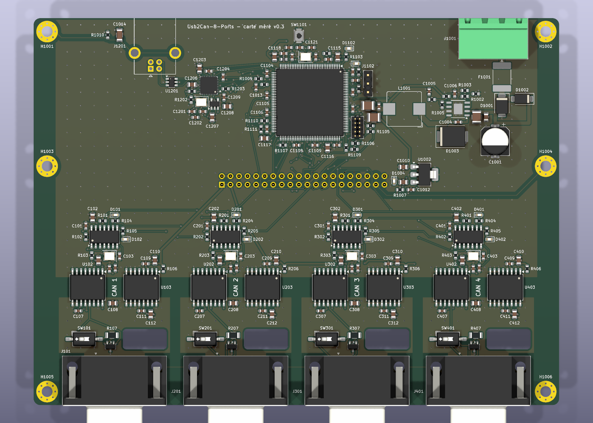
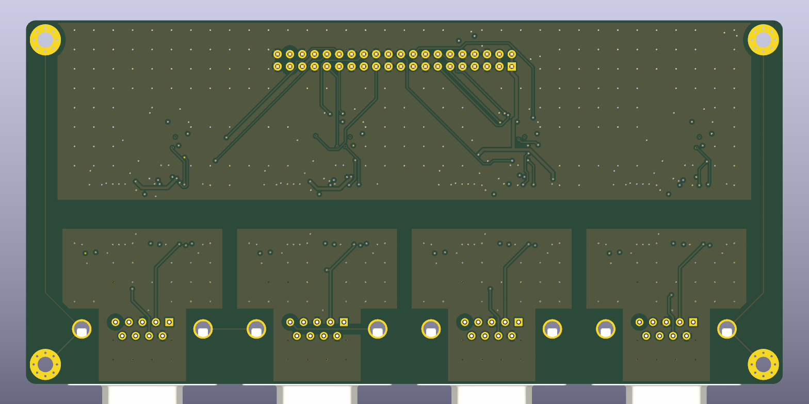
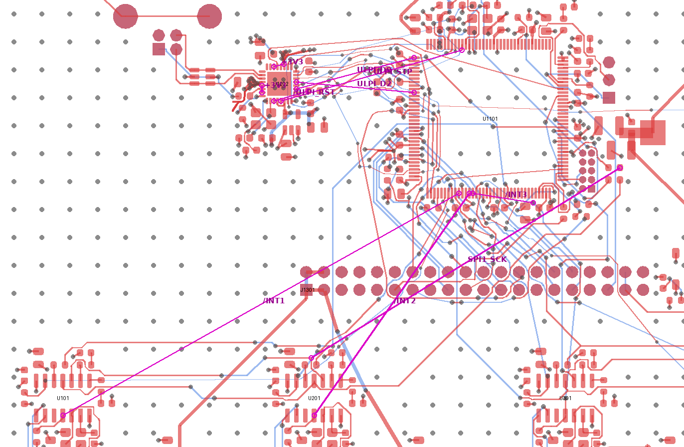

# Routage des cartes (v0.3)

Les deux circuits imprimés sont dans le dépôt :

- `hardware/can8-fille/can8-fille.kicad_pcb` : carte fille, 4 couches, **routée à 100 %** ;
- `hardware/can8-mere/can8-mere.kicad_pcb` : carte mère, 4 couches, **routée sauf 10 liaisons**, à terminer avant fabrication (§ 5 et § 7).

Les projets s'ouvrent dans **KiCad 9** (les empreintes ont été rechargées depuis la bibliothèque KiCad 9). Les sorties de fabrication et les rendus sont dans `hardware/fab/v0.3/`.

| | Dessus | Dessous |
|---|---|---|
| Carte mère |  |  |
| Carte fille |  |  |

Vues de KiCad 9 (`kicad-cli pcb render`). Les vues par couche sont dans `hardware/fab/v0.3/<carte>/<carte>-pcb.pdf`.

## 1. Ce qui est vérifié, et ce qui ne l'est pas

**Vérifié, par les outils de KiCad 9 sur les fichiers livrés :**

| Contrôle | Carte fille | Carte mère |
|---|---|---|
| DRC, règles du projet (isolements, largeurs, bords, trous, zones interdites) | 0 erreur, 0 avertissement | 0 erreur ; avertissements de sérigraphie seulement (contours de connecteurs qui débordent du bord, normal) et 2 vias servant de jonction sur une seule couche |
| Liaisons manquantes | 0 | **10** (liste au § 5) |
| Parité schéma / circuit | 0 écart | 0 écart |
| ERC des schémas | 0 erreur | 0 erreur |

Les seuls avertissements de l'ERC sont « symbole différent de la bibliothèque » : les schémas sont générés avec leur propre copie des symboles, c'est attendu.

Brochages relus sur les fiches techniques pendant ce travail : UCC12050 (broche 16 = GNDS, SEL à VISO = 5,0 V) et AP7361C-33E en SOT223 (1 = IN, 2 = GND, 3 = OUT, conforme à la carte ; voir le point de commande dans [`schema-bloc.md`](schema-bloc.md) § 9).

**Pas vérifié :**

- **Impédances** : la paire USB est dimensionnée par un calcul approché (≈ 90 Ω), à confirmer avec le calculateur du fabricant (§ 2).
- **Intégrité du signal, CEM, thermique** : pas de simulation. Le bus ULPI (60 MHz) est court et sur plan de masse, les longueurs sont données au § 5 sans appairage fin. Pas de calcul thermique du TPS54360 ni de l'AP7361C au-delà de la note de calcul de l'alimentation.
- **Qualité du routage automatique** : les pistes tirées par le routeur sur grille ont des angles quelconques et des détours ; c'est conforme aux règles mais moins propre qu'un routage à la main. Une relecture dans KiCad avant fabrication est recommandée, en particulier autour du STM32 et du PHY USB.
- **Mécanique** : boîtier, hauteur d'empilage, référence exacte du DB9 (voir [`placement.md`](placement.md) § 7).
- Rien n'a été fabriqué ni testé.

## 2. Empilage et couches

Empilage 4 couches 1,6 mm de type JLC04161H-3313, écrit dans le réglage des cartes (KiCad s'en sert pour les plans de fabrication et le calculateur d'impédance) :

| Couche | Épaisseur | Rôle |
|---|---|---|
| F.Cu | 35 µm | composants, signaux rapides (USB, ULPI, SPI), plans GND / GND_ISO entre les pistes |
| prépreg 3313 | 0,0994 mm, εr 4,1 | |
| In1.Cu | 15 µm | **plan de masse plein** : GND sous la partie logique, un GND_ISO par port côté bus |
| cœur | 1,265 mm, εr 4,6 | |
| In2.Cu | 15 µm | **plan d'alimentation plein** : +3V3 sous la partie logique, un VISO par port côté bus |
| prépreg 3313 | 0,0994 mm, εr 4,1 | |
| B.Cu | 35 µm | signaux, plans GND / GND_ISO entre les pistes |

Aucune piste ne passe sur In1 ni sur In2 : les signaux de F.Cu ont un plan de masse continu juste dessous (0,1 mm), et le plan +3V3 n'est pas découpé. Finition ENIG.

**Paire USB D+/D-** : 0,2 mm de large, 0,25 mm d'écart, sur F.Cu au-dessus du plan de masse. Avec cet empilage, le calcul donne environ 90 Ω différentiels (85 à 95 Ω selon l'épaisseur de cuivre et le vernis retenus), dans la tolérance de l'USB 2.0 (90 Ω ± 15 %). **À confirmer avec le calculateur d'impédance du fabricant** ; il suffira d'ajuster l'écart.

## 3. Barrière d'isolement

- Bande de 6 mm (y = 77 à 83 mm) sans aucun cuivre sur les 4 couches, sous chaque ISO1042 et UCC12050 : zones interdites dans les fichiers, contrôlées par le DRC.
- Bande de 3 mm sans cuivre entre deux ports côté bus : les masses isolées de deux ports voisins ne se touchent sur aucune couche.
- Les plans côté bus (GND_ISO, VISO) ne débordent pas de leur port. Le cuivre relié au châssis (blindages USB et DB9, trous de fixation, piste du châssis) est à 1 mm au moins des plans (règle « Plans / châssis » des fichiers `.kicad_dru`).

## 4. Méthode

Le routage est produit par `hardware/outils/router.py`, en cinq étapes, à partir des cartes placées de la v0.2 :

1. **Préparation.** Retouches de placement (étage à découpage resserré, USBLC6 dans l'axe de la paire USB). Pré-routage à la main, pistes verrouillées : paire USB, boucle d'entrée et nœud SW du TPS54360, entrée 9-36 V, sortie 5 V. Sur la mère, le bus ULPI (USB3320 vers STM32) est tiré en premier par le routeur sur grille, au plus court, avant tout le reste. Puis un « éventail » : une via vers son plan pour chaque pastille de GND, +3V3, GND_ISO et VISO, au plus près de la pastille.
2. **Routage automatique** par [Freerouting](https://github.com/freerouting/freerouting) 2.5 sur F.Cu et B.Cu.
3. **Liaisons restantes.** Freerouting laisse des liaisons (19 sur la fille, 66 sur la mère) et rétrécit certaines pistes à 0,1 mm près des pastilles. `hardware/outils/grille.py` termine, par tours, avec le DRC de KiCad après chaque tour :
   - grille de 0,05 mm, recherche de chemin A* sur F.Cu et B.Cu avec vias, en respectant les isolements de chaque classe ; les rétreints sont élargis à 0,15 mm ;
   - les pistes en défaut au DRC et les restes en l'air (bouts de piste, vias reliées à une seule couche) sont supprimés ;
   - pour les nets de plan (GND, +3V3, GND_ISO, VISO), une piste courte vers le voisin du même net ou une via dans le cuivre rempli du plan ; les grappes de vias de plan accumulées au fil des tours sont retirées ;
   - en dernier recours, passage étroit (piste de 0,15 mm, via de 0,45 / 0,2 mm, les minimums des règles), puis dégagement : les pistes d'autres nets qui bouchent la sortie d'une broche de boîtier à pas fin sont arrachées et re-routées au tour suivant ;
   - la carte du meilleur tour est gardée.
   
   Deux options ont été essayées puis laissées de côté (désactivées par défaut) : le routage « négocié » (`--negocie`, oscille sur cette carte) et quelques pistes dans le plan +3V3 de In2 (`--in2`, gagne 2 liaisons mais découpe le plan sous le bus ULPI).
4. **Finitions.** Plans GND / GND_ISO sur F.Cu et B.Cu entre les pistes, vias de couture tous les 4 mm environ, repères de sérigraphie rangés en 0,8 mm (masqués quand il n'y a pas de place), empilage.
5. **Contrôles et sorties** : DRC avec parité schéma / circuit, ERC, `hardware/outils/exporter.sh`.

## 5. Résultats

| | Carte fille | Carte mère |
|---|---|---|
| Segments de piste | 942 | 2 473 |
| Vias (dont vias de couture) | 513 (284) | 1 051 (496) |
| Longueur de piste | 2,16 m | 4,12 m |
| Liaisons manquantes | 0 | 10 |

**Paire USB** (J1201 → USBLC6 → USB3320, F.Cu, 0,2 / 0,25 mm) : USB_DP 17,3 mm, USB_DM 17,8 mm, soit 0,5 mm d'écart.

**Bus ULPI** (USB3320 → STM32), longueurs des lignes tirées :

| Ligne | Longueur | Couches |
|---|---|---|
| ULPI_CLK | 37,1 mm | F.Cu, B.Cu |
| ULPI_DIR | 33,2 mm | F.Cu, B.Cu |
| ULPI_NXT | 24,7 mm | F.Cu, B.Cu |
| ULPI_D1 | 23,7 mm | F.Cu, B.Cu |
| ULPI_D3 | 27,0 mm | F.Cu, B.Cu |
| ULPI_D4 | 40,3 mm | F.Cu, B.Cu |
| ULPI_D5 | 39,0 mm | F.Cu, B.Cu |
| ULPI_D6 | 42,8 mm | F.Cu, B.Cu |
| ULPI_D7 | 46,3 mm | F.Cu |
| ULPI_D0, D2, STP | non tirées | |

Toutes les lignes tirées font moins de 50 mm ; l'écart entre la plus courte et la plus longue (23 mm, soit environ 0,15 ns) est faible devant la période de 16,7 ns à 60 MHz. Pas de simulation : à reprendre si l'on veut des longueurs appariées.

### Liaisons qui restent à tirer sur la carte mère



| Net | De | Vers | Cause |
|---|---|---|---|
| +3V3 | U1202 (USB3320) broches 21 et 23 | plan +3V3 | broches de part et d'autre de VBUS (22), pas de place pour une via |
| +3V3 | U1202 broche 14 | plan +3V3 | idem, coin du boîtier encombré |
| ULPI_D0, ULPI_D2 | U1202 broches 3, 5 | STM32 (U1101) broches 37, 47 | sorties du PHY prises par les autres lignes ULPI |
| ULPI_STP | U1202 broche 29 | STM32 broche 26 | idem |
| ~ULPI_RST | U1202 broche 27 | R1203 | idem |
| ~INT1, ~INT2, ~INT3 | STM32 broches 82, 85, 86 | MCP2518FD des ports 1, 2 et 3 | rangée du bas du STM32 et passage vers le connecteur carte à carte saturés |
| SPI1_SCK | R1104 (résistance série près du STM32) | bus SPI1 vers les ports | même zone |

Elles apparaissent en chevelu dans KiCad. Le DRC les liste sous « Liaisons non routées ».

## 6. Règles

| Règle | Valeur |
|---|---|
| Isolement minimal | 0,15 mm |
| Largeur de piste minimale | 0,15 mm |
| Via | 0,6 mm, perçage 0,3 mm (les règles acceptent 0,45 / 0,2 mm) |
| Distance cuivre - bord | 0,5 mm |
| Cuivre châssis - plans | 1 mm |
| Liaison d'une pastille de trou métallisé à un plan | 1 branche au moins (réglage de la carte : les connecteurs traversants sont reliés aux plans internes par 4 branches, une seule suffit sur les plans des couches externes entre deux pistes) |

| Classe | Nets | Piste | Isolement |
|---|---|---|---|
| Default | tous les autres | 0,2 mm | 0,15 mm |
| Puissance | entrée 9-36 V, nœud SW | 1,0 mm | 0,3 mm |
| Alim | +5V, +3V3, +3V3A, +1V8_PHY, VISO | 0,5 mm | 0,2 mm |
| CAN | CANH, CANL, TERM | 0,3 mm | 0,2 mm |
| USB | USB_DP, USB_DM | paire 0,2 / 0,25 mm | 0,15 mm |

## 7. Points ouverts

1. **Terminer les 10 liaisons de la carte mère** avant toute fabrication. Les Gerber de la mère ne sont volontairement pas générés tant que le DRC trouve une liaison manquante (`hardware/fab/v0.3/can8-mere/A-LIRE.md`). Pistes pour y arriver : le routeur interactif de KiCad (pousser / contourner) autour du PHY ; décaler de 1 à 2 mm quelques passifs autour de l'USB3320 (C1206, R1201, R1203) ; pour ~INT1 à ~INT3, choisir d'autres broches libres du STM32 plus proches du connecteur (ce sont de simples entrées d'interruption) ; ou passer la carte mère en 6 couches.
2. **Impédance de la paire USB** : à confirmer avec le calculateur du fabricant (§ 2).
3. **LED des ports 5 à 8**, cachées sous la carte mère : choix en attente (voir [`placement.md`](placement.md) § 7).
4. **Mécanique** : référence exacte du DB9, hauteur d'empilage, position des trous de fixation.
5. **Commande** : AP7361C-33E-13 (SOT223), pas la version « ER » au brochage inversé.

## 8. Régénérer

```sh
# KiCad 9 (pcbnew, kicad-cli) et Freerouting 2.5 (Java 25)
python3 hardware/outils/maj_empreintes_k9.py            # une seule fois, sur les cartes v0.2
for c in can8-mere can8-fille; do
  python3 hardware/outils/router.py preparer $c
  (cd hardware/$c/routage && freerouting -de $c.dsn -do $c.ses -mp 10)
  python3 hardware/outils/router.py importer $c
  python3 hardware/outils/router.py completer $c        # à relancer tant que ça progresse
  python3 hardware/outils/router.py finir $c
done
sh hardware/outils/exporter.sh v0.3
```

Freerouting ne donne pas deux fois le même résultat : relancer ces étapes produit un routage différent, à revérifier. **Une fois une carte retouchée à la main dans KiCad, ne plus relancer les scripts sur cette carte.**
