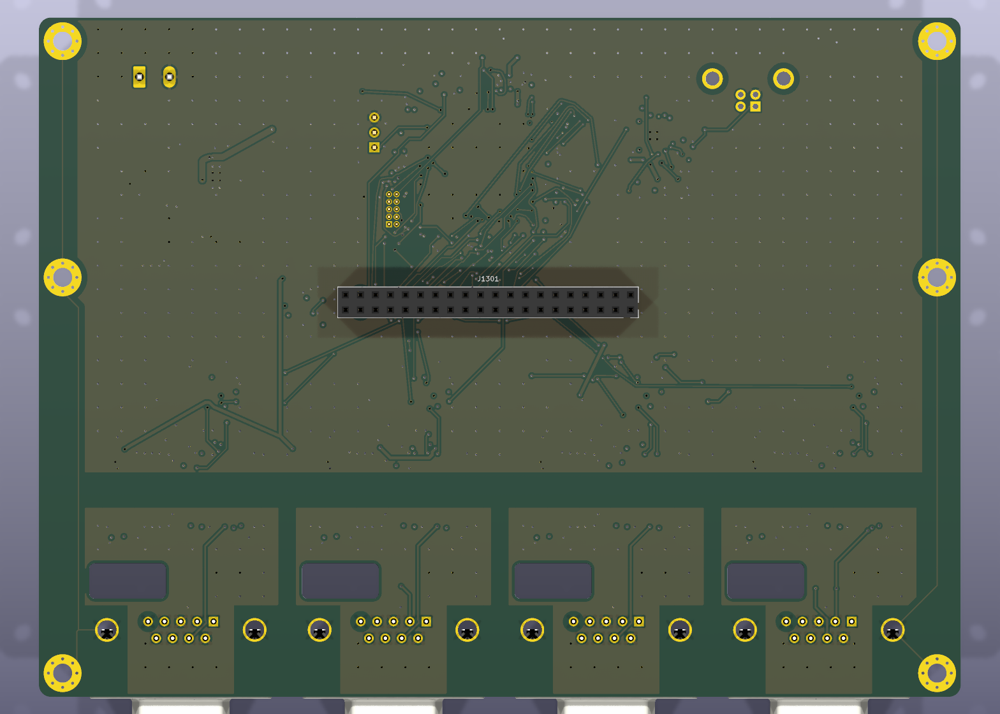
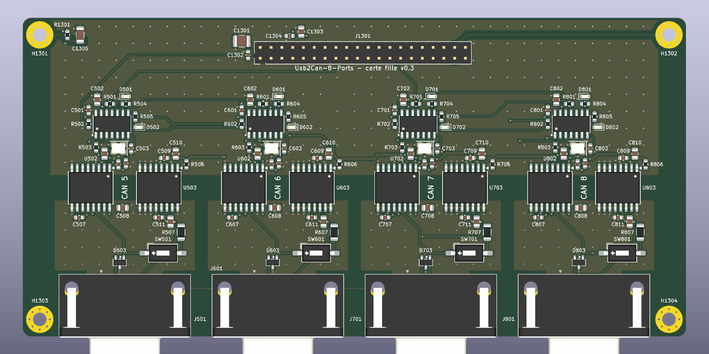

# Routage des cartes (v0.3)

Les deux circuits imprimés sont dans le dépôt :

- `hardware/can8-fille/can8-fille.kicad_pcb` : carte fille, 4 couches, **routée à 100 %** ;
- `hardware/can8-mere/can8-mere.kicad_pcb` : carte mère, 4 couches, **routée à 100 %** (deuxième passe, § 4 et § 5).

Les projets s'ouvrent dans **KiCad 9** (les empreintes ont été rechargées depuis la bibliothèque KiCad 9). Les sorties de fabrication (Gerber, perçages, nomenclature, placement CMS) et les rendus des deux cartes sont dans `hardware/fab/v0.3/`.

| | Dessus | Dessous |
|---|---|---|
| Carte mère |  |  |
| Carte fille |  |  |

Vues de KiCad 9 (`kicad-cli pcb render`). Les vues par couche sont dans `hardware/fab/v0.3/<carte>/<carte>-pcb.pdf`.

## 1. Ce qui est vérifié, et ce qui ne l'est pas

**Vérifié, par les outils de KiCad 9 sur les fichiers livrés :**

| Contrôle | Carte fille | Carte mère |
|---|---|---|
| DRC, règles du projet (isolements, largeurs, bords, trous, zones interdites) | 0 erreur, 0 avertissement | 0 erreur ; avertissements de sérigraphie seulement (11 contours de connecteurs qui débordent du bord, normal ; 1 chevauchement des contours de Y1201 et U1203) et 2 vias servant de jonction sur une seule couche |
| Liaisons manquantes | 0 | 0 |
| Parité schéma / circuit | 0 écart | 0 écart |
| ERC des schémas | 0 erreur | 0 erreur |

Les seuls avertissements de l'ERC sont « symbole différent de la bibliothèque » : les schémas sont générés avec leur propre copie des symboles, c'est attendu.

Brochages relus sur les fiches techniques pendant ce travail : UCC12050 (broche 16 = GNDS, SEL à VISO = 5,0 V) et AP7361C-33E en SOT223 (1 = IN, 2 = GND, 3 = OUT, conforme à la carte ; voir le point de commande dans [`schema-bloc.md`](schema-bloc.md) § 9).

**Pas vérifié :**

- **Impédances** : la paire USB est dimensionnée par un calcul approché (≈ 90 Ω), à confirmer avec le calculateur du fabricant (§ 2).
- **Intégrité du signal, CEM, thermique** : pas de simulation. Le bus ULPI (60 MHz) est court et sur plan de masse, les longueurs sont données au § 5 sans appairage fin. Pas de calcul thermique du TPS54360 ni de l'AP7361C au-delà de la note de calcul de l'alimentation.
- **Qualité du routage automatique** : les pistes tirées par le routeur sur grille ont des angles quelconques et des détours ; c'est conforme aux règles mais moins propre qu'un routage à la main. Sur la carte mère, ~CS3 et SPI1_SCK font de longs détours (§ 5) et 27 vias sont dans des pastilles CMS (§ 7). Une relecture dans KiCad avant fabrication est recommandée, en particulier autour du STM32 et du PHY USB.
- **Mécanique** : boîtier, hauteur d'empilage, référence exacte du DB9 (voir [`placement.md`](placement.md) § 7).
- Rien n'a été fabriqué ni testé.

## 2. Empilage et couches

Empilage 4 couches 1,6 mm de type JLC04161H-3313, écrit dans le réglage des cartes (KiCad s'en sert pour les plans de fabrication et le calculateur d'impédance) :

| Couche | Épaisseur | Rôle |
|---|---|---|
| F.Cu | 35 µm | composants, signaux rapides (USB, ULPI, SPI), plans GND / GND_ISO entre les pistes |
| prépreg 3313 | 0,0994 mm, εr 4,1 | |
| In1.Cu | 15 µm | **plan de masse plein** : GND sous la partie logique, un GND_ISO par port côté bus |
| cœur | 1,265 mm, εr 4,6 | |
| In2.Cu | 15 µm | **plan d'alimentation plein** : +3V3 sous la partie logique, un VISO par port côté bus |
| prépreg 3313 | 0,0994 mm, εr 4,1 | |
| B.Cu | 35 µm | signaux, plans GND / GND_ISO entre les pistes |

Aucune piste ne passe sur In1 ni sur In2 : les signaux de F.Cu ont un plan de masse continu juste dessous (0,1 mm), et le plan +3V3 n'est pas découpé. Finition ENIG.

**Paire USB D+/D-** : 0,2 mm de large, 0,25 mm d'écart, sur F.Cu au-dessus du plan de masse. Avec cet empilage, le calcul donne environ 90 Ω différentiels (85 à 95 Ω selon l'épaisseur de cuivre et le vernis retenus), dans la tolérance de l'USB 2.0 (90 Ω ± 15 %). **À confirmer avec le calculateur d'impédance du fabricant** ; il suffira d'ajuster l'écart.

## 3. Barrière d'isolement

- Bande de 6 mm (y = 77 à 83 mm) sans aucun cuivre sur les 4 couches, sous chaque ISO1042 et UCC12050 : zones interdites dans les fichiers, contrôlées par le DRC.
- Bande de 3 mm sans cuivre entre deux ports côté bus : les masses isolées de deux ports voisins ne se touchent sur aucune couche.
- Les plans côté bus (GND_ISO, VISO) ne débordent pas de leur port. Le cuivre relié au châssis (blindages USB et DB9, trous de fixation, piste du châssis) est à 1 mm au moins des plans (règle « Plans / châssis » des fichiers `.kicad_dru`).

## 4. Méthode

Le routage est produit par `hardware/outils/router.py`, en cinq étapes, à partir des cartes placées de la v0.2 :

1. **Préparation.** Retouches de placement (étage à découpage resserré, USBLC6 dans l'axe de la paire USB). Pré-routage à la main, pistes verrouillées : paire USB, boucle d'entrée et nœud SW du TPS54360, entrée 9-36 V, sortie 5 V. Sur la mère, le bus ULPI (USB3320 vers STM32) est tiré en premier par le routeur sur grille, au plus court, avant tout le reste. Puis un « éventail » : une via vers son plan pour chaque pastille de GND, +3V3, GND_ISO et VISO, au plus près de la pastille.
2. **Routage automatique** par [Freerouting](https://github.com/freerouting/freerouting) 2.5 sur F.Cu et B.Cu.
3. **Liaisons restantes.** Freerouting laisse des liaisons (19 sur la fille, 66 sur la mère) et rétrécit certaines pistes à 0,1 mm près des pastilles. `hardware/outils/grille.py` termine, par tours, avec le DRC de KiCad après chaque tour :
   - grille de 0,05 mm, recherche de chemin A* sur F.Cu et B.Cu avec vias, en respectant les isolements de chaque classe ; les rétreints sont élargis à 0,15 mm ;
   - les pistes en défaut au DRC et les restes en l'air (bouts de piste, vias reliées à une seule couche) sont supprimés ;
   - pour les nets de plan (GND, +3V3, GND_ISO, VISO), une piste courte vers le voisin du même net ou une via dans le cuivre rempli du plan ; les grappes de vias de plan accumulées au fil des tours sont retirées ;
   - en dernier recours, passage étroit (piste de 0,15 mm, via de 0,45 / 0,2 mm, les minimums des règles), puis dégagement : les pistes d'autres nets qui bouchent la sortie d'une broche de boîtier à pas fin sont arrachées et re-routées au tour suivant ;
   - la carte du meilleur tour est gardée.

   Deux options ont été essayées puis laissées de côté (désactivées par défaut) : le routage « négocié » (`--negocie`, oscille sur cette carte) et quelques pistes dans le plan +3V3 de In2 (`--in2`, gagne 2 liaisons mais découpe le plan sous le bus ULPI).
4. **Finitions.** Plans GND / GND_ISO sur F.Cu et B.Cu entre les pistes, vias de couture tous les 4 mm environ, repères de sérigraphie rangés en 0,8 mm (masqués quand il n'y a pas de place), empilage.
5. **Contrôles et sorties** : DRC avec parité schéma / circuit, ERC, `hardware/outils/exporter.sh`.

**Deuxième passe sur la carte mère.** La première passe laissait 10 liaisons autour du PHY USB et du STM32. Elles ont été terminées en retouchant le placement et le brochage, puis à la main ; les scripts appliqués, dans l'ordre, sont gardés dans [`hardware/outils/retouches_mere_v03/`](../hardware/outils/retouches_mere_v03/README.md) :

- **Placement** : le diviseur de mesure de l'entrée (R1008, R1009, C1013, net VIN_MES) quitte le couloir entre l'USB3320 et le STM32 pour l'étage d'alimentation, à côté du bornier ; R1203 (rappel de ~ULPI_RST), C1204 et C1205 (découplage du PHY) sont décalés de 1 à 3 mm.
- **Bus ULPI re-tiré en entier** sur le couloir dégagé, avec une direction préférée par face (F.Cu horizontal, B.Cu vertical) : l'ordre des broches du PHY est l'inverse de celui du STM32, les croisements passent ainsi d'une face à l'autre sans se bloquer. L'ordre de tirage des 12 lignes a été cherché par essais (12 lignes tirées sur l'ordre retenu).
- **Brochage** : ~INT1, ~INT2 et ~INT3 passent de PD13, PD14, PD15 (rangée du bas du STM32, saturée) à PG0, PG1 et PA11. Ce sont de simples entrées d'interruption ; les 8 lignes EXTI restent toutes différentes (0, 1, 11, 2, 3, 4, 5, 6). Le schéma est régénéré avec ce changement ([`schema-bloc.md`](schema-bloc.md) § 3), la parité schéma / circuit est à 0 écart. **À reporter dans le firmware.**
- **Reprises à la main** : vias de plan des broches 38, 39 et 61 du STM32 et de C1104 ; PHY_VBUS de R1201 à la broche 22 du PHY ; ~ULPI_RST sort de la broche 27 du PHY par une via sous la rangée de broches ; C1204 sorti de la zone de l'USB3320 (chevauchement signalé par le DRC).

## 5. Résultats

| | Carte fille | Carte mère |
|---|---|---|
| Segments de piste | 942 | 2 216 |
| Vias (dont vias de couture) | 513 (284) | 1 018 (482) |
| Longueur de piste | 2,16 m | 4,21 m |
| Liaisons manquantes | 0 | 0 |

**Paire USB** (J1201 → USBLC6 → USB3320, F.Cu, 0,2 / 0,25 mm) : USB_DP 17,3 mm, USB_DM 17,8 mm, soit 0,5 mm d'écart.

**Bus ULPI** (USB3320 → STM32), toutes les lignes tirées :

| Ligne | Longueur | Couches |
|---|---|---|
| ULPI_CLK | 17,5 mm | F.Cu, B.Cu |
| ULPI_DIR | 29,7 mm | F.Cu |
| ULPI_NXT | 24,7 mm | F.Cu |
| ULPI_STP | 38,8 mm | F.Cu, B.Cu |
| ULPI_D0 | 22,5 mm | F.Cu, B.Cu |
| ULPI_D1 | 17,9 mm | F.Cu, B.Cu |
| ULPI_D2 | 20,0 mm | F.Cu, B.Cu |
| ULPI_D3 | 24,4 mm | F.Cu, B.Cu |
| ULPI_D4 | 36,6 mm | F.Cu, B.Cu |
| ULPI_D5 | 36,3 mm | F.Cu, B.Cu |
| ULPI_D6 | 35,7 mm | F.Cu, B.Cu |
| ULPI_D7 | 46,4 mm | F.Cu, B.Cu |

Toutes les lignes font moins de 50 mm ; l'écart entre la plus courte et la plus longue (29 mm, soit environ 0,19 ns) est faible devant la période de 16,7 ns à 60 MHz. Pas de simulation : à reprendre si l'on veut des longueurs appariées. ~ULPI_RST (signal lent) fait 56 mm.

**Liaisons tirées en dernier sur la carte mère**, avec des détours :

| Net | Liaison | Longueur ajoutée | Remarque |
|---|---|---|---|
| ~CS3 | STM32 broche 80 → MCP2518FD du port 3 | 66 mm, 7 vias | contourne le STM32 par la droite ; sans conséquence pour un chip select |
| SPI1_SCK | R1104 → MCP2518FD du port 2 | 64 mm, 8 vias | horloge SPI des ports 1 et 2 (107 mm au total, résistance série R1104 en départ) : à raccourcir à la relecture si le SPI doit tourner au maximum du MCP2518FD (20 MHz) |

## 6. Règles

| Règle | Valeur |
|---|---|
| Isolement minimal | 0,15 mm |
| Largeur de piste minimale | 0,15 mm |
| Via | 0,6 mm, perçage 0,3 mm ; 0,45 / 0,2 mm (minimum des règles) pour 60 vias de la carte mère, autour du STM32 et du PHY |
| Distance cuivre - bord | 0,5 mm |
| Cuivre châssis - plans | 1 mm |
| Liaison d'une pastille de trou métallisé à un plan | 1 branche au moins (réglage de la carte : les connecteurs traversants sont reliés aux plans internes par 4 branches, une seule suffit sur les plans des couches externes entre deux pistes) |

| Classe | Nets | Piste | Isolement |
|---|---|---|---|
| Default | tous les autres | 0,2 mm | 0,15 mm |
| Puissance | entrée 9-36 V, nœud SW | 1,0 mm | 0,3 mm |
| Alim | +5V, +3V3, +3V3A, +1V8_PHY, VISO | 0,5 mm | 0,2 mm |
| CAN | CANH, CANL, TERM | 0,3 mm | 0,2 mm |
| USB | USB_DP, USB_DM | paire 0,2 / 0,25 mm | 0,15 mm |

Près des broches à pas fin (STM32, USB3320), les pistes Alim descendent à 0,15 à 0,3 mm sur quelques millimètres : la largeur de classe est une valeur par défaut, pas un minimum contrôlé par le DRC.

## 7. Points ouverts

1. **Vias dans les pastilles (carte mère)** : 27 vias sont dans des pastilles CMS (sans compter les 4 vias thermiques voulues sous l'USB3320), posées par les routeurs automatiques ; la carte fille n'en a aucune. Pour un assemblage par refusion, soit les faire boucher par le fabricant (option « via in pad »), soit les décaler à la main dans KiCad. La liste (31 lignes avec les 4 vias thermiques) est donnée par `python3 hardware/outils/vias_pastilles.py hardware/can8-mere/can8-mere.kicad_pcb`.
2. **Relecture du routage de la carte mère** dans KiCad, en particulier les détours de ~CS3 et SPI1_SCK (§ 5).
3. **Firmware** : ~INT1, ~INT2, ~INT3 sont sur PG0, PG1, PA11 (EXTI 0, 1, 11), plus sur PD13 à PD15.
4. **Impédance de la paire USB** : à confirmer avec le calculateur du fabricant (§ 2).
5. **LED des ports 5 à 8**, cachées sous la carte mère : choix en attente (voir [`placement.md`](placement.md) § 7).
6. **Mécanique** : référence exacte du DB9, hauteur d'empilage, position des trous de fixation.
7. **Commande** : AP7361C-33E-13 (SOT223), pas la version « ER » au brochage inversé.

## 8. Régénérer

```sh
# KiCad 9 (pcbnew, kicad-cli) et Freerouting 2.5 (Java 25)
python3 hardware/outils/maj_empreintes_k9.py            # une seule fois, sur les cartes v0.2
for c in can8-mere can8-fille; do
  python3 hardware/outils/router.py preparer $c
  (cd hardware/$c/routage && freerouting -de $c.dsn -do $c.ses -mp 10)
  python3 hardware/outils/router.py importer $c
  python3 hardware/outils/router.py completer $c        # à relancer tant que ça progresse
  python3 hardware/outils/router.py finir $c
done
sh hardware/outils/exporter.sh v0.3
```

Freerouting ne donne pas deux fois le même résultat : relancer ces étapes produit un routage différent, à revérifier. La deuxième passe de la carte mère (§ 4) s'applique à la main, script par script, sur le résultat de la première ([`retouches_mere_v03/`](../hardware/outils/retouches_mere_v03/README.md)). **Une fois une carte retouchée à la main dans KiCad, ne plus relancer les scripts sur cette carte.**
