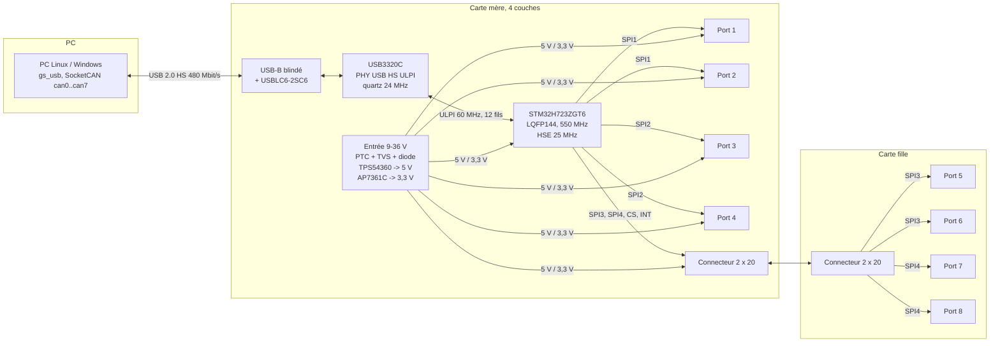
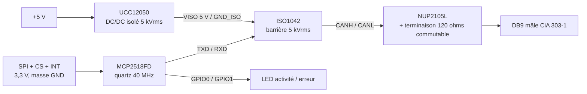

# Schéma-bloc, affectation des broches et nomenclature (v0.2)

Ce document accompagne le schéma KiCad (v0.2, après vérifications) (`hardware/can8-mere/` et `hardware/can8-fille/`).
Il applique les décisions D1 à D6 de [`decisions.md`](decisions.md). Les prix sont des ordres de grandeur unitaires en petites quantités, à vérifier au moment de commander.

## 1. Schéma-bloc

Chaque bloc « Port n » est la même feuille KiCad (`port_can.kicad_sch`), utilisée 4 fois sur chaque carte :

Il y a 9 domaines de masse : GND (logique, USB, alimentation) et GND_ISO des ports 1 à 8, tous séparés. Le châssis (trous de fixation, blindages USB et DB9) est relié à GND par 1 Mohm en parallèle avec 4,7 nF 2 kV.

## 2. Arbre d'alimentation

| Rail | Source | Consommateurs | Courant max estimé |
|---|---|---|---|
| +VIN (9 à 36 V) | Bornier débrochable, PTC 1,1 A, TVS SMBJ36CA, diode série SS310 | TPS54360, mesure VIN_MES (ADC) | ≈ 0,9 A à 9 V |
| +5 V | TPS54360 (60 V, 3,5 A, ~500 kHz) | 8 × UCC12050, LDO 3,3 V | ≈ 1,5 A |
| +3V3 | AP7361C-33 (1 A, SOT-223) depuis le 5 V | MCU, USB3320, 8 × MCP2518FD, côté logique des 8 ISO1042, LED | ≈ 0,5 A |
| +1V8_PHY | AP2112K-1.8 depuis le 3,3 V | VDD18 du USB3320 (entrée externe obligatoire) | < 50 mA |
| VISO (×8) | UCC12050 de chaque port, réglé à 5,0 V (SEL relié à VISO) | côté bus de l'ISO1042 | ≈ 70 mA bus dominant |

Le LDO 3,3 V dissipe ≈ 0,85 W au pire (1,7 V × 0,5 A) : prévoir une surface de cuivre sous la languette du SOT-223.

## 3. Affectation des broches du STM32H723ZGT6 (LQFP144)

| Fonction | Broches | Remarques |
|---|---|---|
| ULPI (OTG_HS) | CK PA5, STP PC0, DIR PC2_C, NXT PC3_C, D0 PA3, D1 PB0, D2 PB1, D3 PB10, D4 PB11, D5 PB12, D6 PB13, D7 PB5 | PC2_C/PC3_C : fermer l'interrupteur analogique (SYSCFG_PMCR PC2SO/PC3SO) |
| Reset PHY | PC6 (`~ULPI_RST`) | pull-up 10 kohms, PHY actif par défaut |
| SPI1, ports 1-2 | SCK PG11, MISO PG9, MOSI PD7 | carte mère |
| SPI2, ports 3-4 | SCK PD3, MISO PB14, MOSI PB15 | carte mère |
| SPI3, ports 5-6 | SCK PC10, MISO PC11, MOSI PC12 | via le connecteur carte à carte |
| SPI4, ports 7-8 | SCK PE12, MISO PE13, MOSI PE14 | via le connecteur carte à carte |
| Chip-selects | CS1 PD9, CS2 PD10, CS3 PD11, CS4 PD12, CS5 PE7, CS6 PE8, CS7 PE9, CS8 PE10 | GPIO, pull-up 10 kohms côté contrôleur |
| Interruptions | INT1 PD13, INT2 PD14, INT3 PD15, INT4 PG2, INT5 PG3, INT6 PG4, INT7 PG5, INT8 PG6 | 8 lignes EXTI distinctes (13, 14, 15, 2, 3, 4, 5, 6) |
| SWD | SWDIO PA13, SWCLK PA14, SWO PB3, NRST | connecteur Cortex 10 broches 1,27 mm |
| UART de débogage | TX PB6, RX PB7 (USART1) | barrette 3 broches |
| LED | état PE0, erreur PE1 | |
| Mesure VIN | PC4 (ADC) | pont 100 k / 8,2 k : 36 V -> 2,73 V |
| Présence carte fille | PF0 (`~FILLE_PRESENTE`) | pull-up sur la carte mère, mis à la masse par la carte fille |
| Horloge | HSE 25 MHz sur PH0/PH1 | l'horloge ULPI 60 MHz vient du PHY |
| Libres | SPI5 (PF7/PF8/PF9), SPI6 (PG13/PG12/PG14), ~70 GPIO | permettent plus tard un bus SPI par port |

Les résistances série de 33 ohms sont placées côté MCU sur SCK et MOSI, et côté contrôleur sur MISO (SDO).

## 4. Connecteur carte à carte (2 × 20, pas 2,54 mm)

Carte mère : embase femelle, montée au dos. Carte fille : barrette mâle, sur le dessus. Une masse est placée à côté de chaque horloge SPI. Les deux empreintes KiCad sont en miroir l'une de l'autre : une fois empilées, les broches de même numéro se font face (vérifié par `placer.py`, voir [`placement.md`](placement.md)).

| Broche | Signal | Broche | Signal |
|---|---|---|---|
| 1 | +5V | 2 | +5V |
| 3 | +5V | 4 | +5V |
| 5 | GND | 6 | GND |
| 7 | +3V3 | 8 | +3V3 |
| 9 | GND | 10 | GND |
| 11 | SPI3_SCK | 12 | GND |
| 13 | SPI3_MOSI | 14 | SPI3_MISO |
| 15 | GND | 16 | GND |
| 17 | ~CS5 | 18 | ~CS6 |
| 19 | ~INT5 | 20 | ~INT6 |
| 21 | GND | 22 | GND |
| 23 | SPI4_SCK | 24 | GND |
| 25 | SPI4_MOSI | 26 | SPI4_MISO |
| 27 | GND | 28 | GND |
| 29 | ~CS7 | 30 | ~CS8 |
| 31 | ~INT7 | 32 | ~INT8 |
| 33 | GND | 34 | GND |
| 35 | ~FILLE_PRESENTE | 36 | GND |
| 37 | CHASSIS | 38 | CHASSIS |
| 39 | GND | 40 | GND |

## 5. Nomenclature des composants clés

La nomenclature complète, générée depuis le schéma, est dans `hardware/can8-mere/can8-mere-nomenclature.csv` et `hardware/can8-fille/can8-fille-nomenclature.csv`.

| Fonction | Référence | Boîtier | Qté | Prix unitaire indicatif | Sous-total |
|---|---|---|---|---|---|
| Microcontrôleur | STM32H723ZGT6 | LQFP-144 | 1 | ≈ 10 à 12 € | ≈ 11 € |
| PHY USB High Speed | USB3320C-EZK | QFN-32 5 × 5 | 1 | ≈ 2 € | ≈ 2 € |
| Contrôleur CAN FD | MCP2518FD-E/SL | SOIC-14 | 8 | ≈ 2 € | ≈ 16 € |
| Quartz 40 MHz (un par contrôleur) | 3225, ±30 ppm | 3,2 × 2,5 mm | 8 | ≈ 0,4 € | ≈ 3 € |
| Transceiver CAN FD isolé | ISO1042BDWR | SOIC-16 large | 8 | ≈ 3,5 € | ≈ 28 € |
| DC/DC isolé 500 mW | UCC12050DVER | SOIC-16 large | 8 | ≈ 6 € | ≈ 48 € |
| Protection ESD bus CAN | NUP2105L | SOT-23 | 8 | ≈ 0,3 € | ≈ 2 € |
| Connecteur bus | DB9 mâle coudé avec fixations | traversant | 8 | ≈ 1,5 € | ≈ 12 € |
| Abaisseur 9-36 V -> 5 V | TPS54360DDA | SO-8 PowerPAD | 1 | ≈ 3 € | ≈ 3 € |
| Protection d'entrée | PTC Littelfuse 2920L110/60MR, TVS SMBJ36CA, diode SS310 | CMS | 1 jeu | ≈ 1,5 € | ≈ 1,5 € |
| LDO 3,3 V | AP7361C-33E | SOT-223 | 1 | ≈ 0,5 € | ≈ 0,5 € |
| LDO 1,8 V (PHY) | AP2112K-1.8 | SOT-23-5 | 1 | ≈ 0,3 € | ≈ 0,3 € |
| Protection USB | USBLC6-2SC6 | SOT-23-6 | 1 | ≈ 0,4 € | ≈ 0,4 € |
| Connecteur USB | USB-B coudé blindé | traversant | 1 | ≈ 1 € | ≈ 1 € |
| Entrée alimentation | Phoenix MSTB 2,5/2-GF-5,08 + fiche MSTB 2,5/2-STF-5,08 | traversant | 1 | ≈ 3 € | ≈ 3 € |
| Liaison carte à carte | barrette 2 × 20 + embase 2 × 20, pour un empilage de ≈ 15 mm | traversant | 1 paire | ≈ 2 à 6 € | ≈ 2 à 6 € |

Total des composants clés : ≈ 130 € par carte complète, hors passifs et circuits imprimés. Le poste principal est l'isolation (ISO1042 + UCC12050 ≈ 76 €), un peu au-dessus de l'estimation de D2 (40 à 60 €), parce que le UCC12050 a été préféré à un module DC/DC bon marché (voir les choix ouverts).

## 6. Choix faits dans ce premier jet

- **Un quartz 40 MHz par MCP2518FD** (question laissée ouverte par D6) : une panne d'horloge ne touche qu'un port, au prix de 8 quartz au lieu de 2 oscillateurs.
- **MCP2518FD en SOIC-14** plutôt qu'en VDFN : soudure et inspection plus faciles, aucune différence électrique.
- **DC/DC isolé UCC12050** : isolation renforcée 5 kVrms comme l'ISO1042, CMS, broche EN (permet plus tard de couper un port). Alternative moins chère : module 1 W type B0505S (≈ 1,5 à 3 €, 1 à 1,5 kV, plus encombrant).
- **USB3320 en 3,3 V externe** : VBAT et VDD33 reliés au 3,3 V comme le prévoit la datasheet ; VDD18 est une entrée, d'où un LDO 1,8 V dédié.
- **Alimentation 5 V par un abaisseur non synchrone 60 V** (TPS54360 + diode B560C) : marge sur les surtensions 24 V, protégée par la TVS SMBJ36CA.
- **Terminaison 120 ohms par micro-interrupteur, un par port** (décidé par Nicolas le 2026-11-20, plutôt qu'une commande par logiciel) : placé juste derrière le DB9. Ceux de la carte fille sont accessibles par une fenêtre découpée dans la carte mère (voir [`placement.md`](placement.md)).
- **LED par port pilotées par le MCP2518FD** (GPIO0 = activité, GPIO1 = erreur) : aucun fil supplémentaire sur le connecteur carte à carte.

## 7. Choix ouverts

| Sujet | Options | Recommandation |
|---|---|---|
| DC/DC isolé | UCC12050 (dessiné, ≈ 6 €) ou module 1 W (≈ 2 €) | UCC12050, cohérent avec la priorité à la robustesse |
| Fixation des DB9 | DB9 coudés sur le bord de chaque carte, cartes empilées à ≈ 15 mm (le DB9 de la fille, ≈ 12,6 mm de haut, passe sous la mère) | à confirmer avec le boîtier choisi, voir [`placement.md`](placement.md) |

## 8. Vérifications faites (v0.2)

| Point | Résultat | Source |
|---|---|---|
| USB3320, code REFSEL[2:0] | **111** (les trois broches au VDDIO, ici +3V3) pour une référence 24 MHz. Les ponts de réglage sont supprimés. | DS00001792, Table 5-10 |
| USB3320, résistance VBUS | **10 kohms ± 5 %** pour un périphérique seul (1 kohm est la valeur OTG). Corrigé : le premier jet avait 1 kohm. | DS00001792, Table 5-7 |
| USB3320, quartz 24 MHz | Fondamental, CL 20 pF, ESR ≤ 30 ohms : charge 2 × 33 pF (3 pF de broche, ≈ 2 pF de circuit imprimé) | DS00001792, Table 4-11 |
| TPS54360 | 500 kHz (RT 200 kohms), UVLO 8 V / 6,25 V (523 k / 84,5 k), L = 15 µH (Isat ≥ 6 A), compensation 9,09 kohms + 15 nF // 68 pF | [`calculs-alimentation.md`](calculs-alimentation.md) |
| PTC d'entrée | Littelfuse 2920L110/60MR (60 V, 1,1 A) | [`calculs-alimentation.md`](calculs-alimentation.md) |
| Bornier d'alimentation | Phoenix MSTB 2,5/2-GF-5,08 (embase à brides filetées : la fiche se visse, elle ne peut pas se débrancher par vibration) | empreinte KiCad `Connector_Phoenix_MSTB` |
| VCAP du STM32H723 | un 2,2 µF par broche VCAP, sur deux nets séparés (deux sorties d'alimentation ne doivent pas être reliées entre elles) | règles électriques |
| Quartz HSE 25 MHz | charge 2 × 15 pF pour un quartz CL 10 pF | ST AN2867 |
| Empreintes | toutes présentes dans les bibliothèques KiCad (contrôle automatique) | `verifier_netlist.py` |
| Règles électriques | 0 erreur : entrées d'alimentation alimentées, pas deux sorties sur un net, pas d'entrée sans source, pas de net à une broche | `verifier_netlist.py` (l'ERC de KiCad 7 n'est pas disponible en ligne de commande) |

## 9. Reste à vérifier

1. **DB9** : l'empreinte retenue (`DSUB-9_Male_Horizontal_P2.77x2.84mm_EdgePinOffset9.90mm_Housed_MountingHolesOffset11.32mm`) correspond aux DB9 coudés à fixation par vis, avec les broches à 9,9 mm du bord. La référence exacte est à choisir avec le boîtier.
2. ~~**UCC12050** : broche 16~~ : vérifié en v0.3, la broche 16 est bien GNDS (table des broches de TI), et SEL relié à VISO donne 5,0 V.
3. ~~**ERC de KiCad**~~ : fait en v0.3 avec KiCad 9 sur les deux schémas, 0 erreur (seulement des avertissements « symbole différent de la bibliothèque », normaux pour des schémas générés).
4. **AP7361C** : brochage vérifié en v0.3 sur la fiche Diodes DS37274 (boîtier SOT223, suffixe « E ») : 1 = IN (+5V), 2 = GND, 3 = OUT (+3V3), comme sur la carte (la languette de l'empreinte KiCad est la broche 2, donc sur GND ; la fiche ne la décrit pas, la convention SOT-223 est celle-là). **Commander la référence AP7361C-33E-13, pas -33ER-13** : la version « ER » (SOT223R) a un autre brochage (1 = GND, 2 = OUT, 3 = IN).
5. **Quartz** : ajuster les condensateurs de charge au CL réel des quartz achetés (24, 25 et 40 MHz).
6. **Placement** : hauteur d'empilage, connecteur carte à carte, LED des ports 5 à 8 et trous de fixation, voir [`placement.md`](placement.md) § 7.
